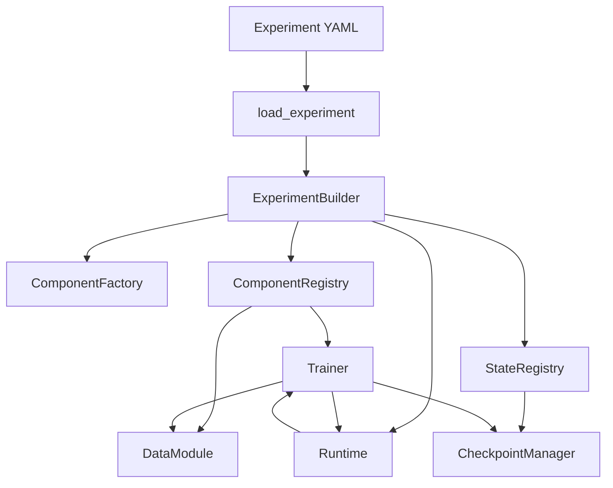
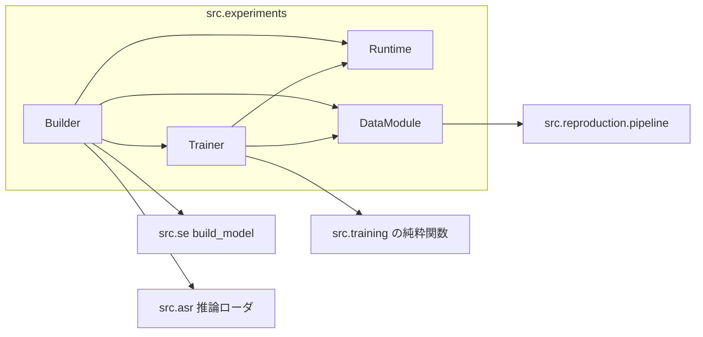

# Experiment Framework アーキテクチャ

Phase 1、CPU / FP32 の checkpoint（Phase 2-A）、CPU / Gloo の DDP（Phase 2-B）、CUDA / NCCL / AMP FP16（Phase 2-C）は `src/experiments/` に実装済みである。固定ペアの Data System（Phase 3-B）、chunk の Data Pipeline（Phase 3-C）、オンラインの Data Pipeline（Phase 3-D）、CPU / Gloo の world size 2 Data System（Phase 3-E）、平坦 Sampler の動的重み（Phase 3-F）も実装済みで、記録は [PHASE_3B_FIXED_PAIR.md](PHASE_3B_FIXED_PAIR.md)、[PHASE_3C_CHUNK.md](PHASE_3C_CHUNK.md)、[PHASE_3D_ONLINE.md](PHASE_3D_ONLINE.md)、[PHASE_3E_DISTRIBUTED_DATA.md](PHASE_3E_DISTRIBUTED_DATA.md)、[PHASE_3F_WEIGHTED_SAMPLING.md](PHASE_3F_WEIGHTED_SAMPLING.md)。FSDP、sharded checkpoint、AMP BF16 は未実装。Phase 4-A の MP-SENet Waveform L1、Phase 4-B の TF-GridNet MS-SNSD、Phase 4-C の TF-Locoformer DNS、Phase 4-D の MP-SENet 公式 GAN、Phase 4-E の MossFormerGAN 公式 GAN は実装済みである。Phase 4-F は 4 モデルの横断検証で、公式 chunk YAML の prepare は `ddp` である。TF-GridNet の公式 YAML は world size 2、TF-Locoformer の公式 YAML は world size 4 で構築する。world size 1 は batch 不一致で拒否する。DeepFilterNet3 と SEMamba++ の本格学習は未実装。記録は [PHASE_4A_MP_SENET_CONNECTION.md](PHASE_4A_MP_SENET_CONNECTION.md)、[PHASE_4B_TF_GRIDNET_TRAINING.md](PHASE_4B_TF_GRIDNET_TRAINING.md)、[PHASE_4C_TF_LOCOFORMER_TRAINING.md](PHASE_4C_TF_LOCOFORMER_TRAINING.md)、[PHASE_4D_MP_SENET_GAN.md](PHASE_4D_MP_SENET_GAN.md)、[PHASE_4E_MOSSFORMERGAN_TRAINING.md](PHASE_4E_MOSSFORMERGAN_TRAINING.md)、[PHASE_4F_INTEGRATION.md](PHASE_4F_INTEGRATION.md)。Phase 2-A の単一プロセス復元は [PHASE_2A_CHECKPOINT.md](PHASE_2A_CHECKPOINT.md)、Phase 2-B の DDP と world size 2 の再開は [PHASE_2B_DDP.md](PHASE_2B_DDP.md)、Phase 2-C の CUDA と AMP は [PHASE_2C_CUDA_AMP.md](PHASE_2C_CUDA_AMP.md)。供給 API は [DATA_ARCHITECTURE.md](DATA_ARCHITECTURE.md) と [DATA_PUBLIC_API.md](DATA_PUBLIC_API.md)。以下のうちデータ供給の配置は Phase 3-A で更新し、固定ペアは Phase 3-B、chunk は Phase 3-C、オンラインは Phase 3-D、world size 2 の prefetch と rank 分担は Phase 3-E、平坦 Sampler の重み付き抽選は Phase 3-F でコードにした。それ以外は Phase 0 の設計仕様であり、`src/training/` の学習ループは変更しない。`src/reproduction/pipeline/planner.py` には固定ペアの crop、長さ、pad、plan index の公開委譲と、chunk の計画長 `chunk_case_length` を足した。式は変えていない。

この文書の「現行」は、2026-11-08 に `feature/experiment-framework` のソースを読んだ事実である。「設計」は新しい枠組みの提案であり、現行コードにあるものとして扱わない。公式再現の数値的同等性は、この設計書では保証しない。

## 背景と目的

現行の学習は `python -m src.training.se.cli` から一つの `Trainer` と、モデル名で分岐する Task に入る。Task がモデル、損失、Optimizer、Scheduler、DDP の包み方、更新順をまとめて持つ。この形は MP-SENet、MossFormerGAN、TF-GridNet、TF-Locoformer、DeepFilterNet3、SEMamba++ の公式手順を保つのに向いている。

研究側では、次をコードの追加で表現したい。

- 通常の教師あり音声強調
- 複数 Optimizer の GAN
- 固定 ASR を使う ASR-aware SE
- 任意の Loss と Optimizer の比較
- LoRA や部分 Fine-tuning
- 難例の反復学習
- 複数 Expert の学習、選択、統合
- Dynamic Routing、MoE、Distillation
- 上記に収まらない独自アルゴリズム

学習手順を YAML の DSL にしない。YAML はクラス、初期化引数、明示した参照、実験設定だけを持つ。アルゴリズムは Python の Trainer に書く。

## 現行アーキテクチャの調査

### 呼び出し経路

事実。入口は `src/training/se/cli.py` の `main`。

1. `--preflight` のとき `src.training.se.preflight.run_preflight`。学習は始めない。
2. それ以外は `src.training.se.run.execute`。
3. `execute` は `load_training_config`、GPU 空き確認、`set_determinism`、`setup_process`、`plan_batches`、`build_task`、データ経路の分岐、`Trainer.fit` の順。
4. `build_task` は `model.name` と `loss` の文字列で Task クラスを選ぶ。未知の名前は `TrainingError`。

Task の対応（`build_task`）:

| 条件 | クラス |
|---|---|
| `mp_senet` | `MPSENetTask` |
| `tf_gridnet` かつ `loss == waveform_l1` | `WaveformTask` |
| `tf_gridnet` | `TFGridNetTask` |
| `semambapp` | `SEMambaTask` |
| `mossformergan` | `MossFormerGANTask` |
| `deepfilternet3` | `DeepFilterNetTask` |
| `tf_locoformer` | `TFLocoformerTask` |

新しいモデルを足すと `build_task` と `load_training_config` の許可リストを編集する。Factory ではない。

### データ経路

事実。`execute` は `data.pipeline` で三系統に分かれる。

| 条件 | 関数 | Trainer のループ |
|---|---|---|
| `pipeline: reproduction` かつ `chunk_iterator` | `src.reproduction.pipeline.pregenerated.open_chunk_datasets` | `Trainer._run_chunk_epochs` |
| `pipeline: reproduction` | `src.reproduction.pipeline.training_data.open_training_data` | `Trainer._run_data_epochs` |
| それ以外（キー無しは legacy） | `src.training.data.dataset.load_recipe_dataset` | `Trainer._run_epochs` |

`open_training_data` はスナップショットの `kind == online_mixing` なら `OnlineDFN3TrainingData` または `OnlineSemambaTrainingData` を返す。それ以外の固定ペアは `ReproductionTrainingData`。学習プロセスは DuckDB を開かない。`require_on_demand` は `rule_json.delivery == on_demand` 以外を拒否する。

`execute` はモデル名と dataset algorithm を次の組だけ許す。

- chunk: `(tf_gridnet, pregenerated.ms_snsd_tfgridnet)`、`(tf_locoformer, pregenerated.dns_tflocoformer)`
- 非 chunk: `mp_senet` / `fixed_pair.mp_senet`、`mossformergan` / `fixed_pair.mossformergan_se_16k`、`deepfilternet3` / `online.dfn3`、`semambapp` / `online.semambapp_gsr`

`LegacyTrainingData`（`src/training/data/legacy.py`）は `RecipeDataset` を `epoch` / `validation` / `data_state` に見せる。`execute` の legacy 分岐はこれを使わず、`RecipeDataset` を `Trainer._run_epochs` に直接渡す。

公式の信号処理は `src/reproduction/protocols/` と `pipeline/` の専用実装にある。共通の混合エンジンは無い（`.agents/DECISIONS.md` の採用済み方針）。

順序は純関数である。`src/training/data/sampler.py` の `epoch_indices` と `crop_start` は `(seed, epoch, case_id)` から再計算する。`src/reproduction/pipeline/order.py` の `OrderPolicy` は公式の sampler 差を個別に再現する。先読みした未使用バッチは再開位置に数えない。

Sample の識別子は、legacy ではレシピの `case_id`、reproduction ではスナップショットの case と計画上の index である。オンライン混合の波形は `(protocol, snapshot, seed, split, epoch, index)` から再計算し、乱数生成器の残状態は保存しない。

### Task と Optimizer

事実。各 Task の `__init__` が `build_model`（`src.se.api`）またはモデル固有コンストラクタでモジュールを作り、その場で Optimizer と Scheduler を作る。`distribute` はその後に DDP で包む。`load_state_dict` は DDP 済みだと `TrainingError` にする。したがって再開は wrap の前である。

| Task | Optimizer | 更新の特徴 |
|---|---|---|
| `MPSENetTask` | Generator と Discriminator の AdamW。公式損失のとき両方。`reconstruction` は Generator のみ | 公式損失は micro-batch の Generator forward を貯めてから Discriminator を更新し、その後 Generator を backward する。DDP の Generator 勾配は全 backward の後に手動 `all_reduce` |
| `MossFormerGANTask` | Generator の AdamW（weight decay 0.01）と、学習率が 2 倍の Discriminator | PESQ 欠測は backward しない。world size 2 以上は全 rank が同じ micro-batch を落とす。`update_applied` が 0 のとき Trainer は `global_step` を進めない。データ cursor は進む |
| `TFGridNetTask` | 単一 Adam / AdamW | `mr_l1_tfd`。最後の micro-batch だけ DDP 同期。勾配クリップ後に `optimizer.step`。epoch 末に Scheduler |
| `TFLocoformerTask` | 単一 AdamW | 同上に加え、`WarmupReduceLROnPlateau.step_batch` を Optimizer 更新の直後に呼ぶ。plateau は epoch 末 |
| `DeepFilterNetTask` | 単一 | cosine を Optimizer 更新の前に適用。`df_fc_a` は forward で未使用 |
| `SEMambaTask` | Generator と Discriminator | 損失は平均。蓄積 2 以上は Discriminator 更新後に Generator を micro-batch ごとに forward し直す |

`src/training/se/optim.py` の `build_optimizer` は設定の `optimizer.name` が `adamw` か `adam` のときだけ動く。パラメータ集合は呼び出し側が渡す。`clip_gradients` は `clip_grad_norm_`。

AMP（`autocast` / `GradScaler`）は `src/training/` に無い。`.agents/DECISIONS.md` の項目 25 は、現行の公式再現の高速化には AMP を入れていない、と記録している。Experiment Framework の AMP FP16 は Phase 2-C で `src/experiments/` に入った。`src/training/` の経路は変えていない。

`src/training` は `src.asr` を import しない。ASR-aware の学習経路は現行コードに無い。`src.asr.transcribe` は `torch.inference_mode()` で、勾配を通す契約ではない。

### Trainer のループと状態

事実。`src/training/core/trainer.py` の `Trainer` がループを所有する。Task は `train_update(batches, accumulation)` を実装する。共通の `train_step` 抽象メソッドは無い。

`global_step` は Optimizer 更新を 1 回受け入れた回数である。`_accept_optimizer_update` は `update_applied` が無い指標を更新成功とみなす。分散時は全 rank の `update_applied` が一致しなければ `TrainingError`。

検証、Scheduler、checkpoint、停止は Trainer がタイミングを決める。Task の `step_schedulers` は Trainer から呼ばれる。TF-Locoformer の warmup だけは Task が更新の直後に進める。

停止状態は `status.json` の `RUNNING` / `CHECKPOINTED` / `INTERRUPTED` / `COMPLETED` / `FAILED`。公式完了の `complete.json` があると再開しない。`SIGTERM` は現在の更新を終えてから checkpoint を書く。world size 2 以上で `deadline` と `segment_steps` は拒否する。

### DDP、勾配蓄積、複数 Optimizer

事実。

- `setup_process` は `WORLD_SIZE > 1` のときだけ process group を作る。CPU は gloo、CUDA は nccl。
- `wrap_module` が `DistributedDataParallel` を付ける。world size 1 はモジュールをそのまま返す。
- `accumulation_scope` は最後以外の forward を `no_sync()` で包む。コメントどおり、forward 時に all-reduce が決まる。`backward()` は `loss.backward()` だけで、`no_sync` を掛け直さない。
- 損失を蓄積回数で割るのは Task 側である。
- MP-SENet の公式損失は、複数 forward の後に backward するため `no_sync` を常に使い、最後に Generator 勾配を平均する。
- MossFormerGAN は micro-batch ごとに勾配増分を平均し、走っている和を clip する。公式 DDP の 2 回目 Discriminator backward は all-reduce されない。audio-db はその増分を平均するので、公式 2 GPU の重みとは一致しない（`.agents/DECISIONS.md` 項目 45、47）。
- MossFormerGAN の CUDA かつ world size 2 以上だけ `SyncBatchNorm` に変換する。CPU の複数 rank は BatchNorm のまま。

FSDP は無い。

### Checkpoint と RNG

事実。形式文字列は `audio-db-training-v1`。`save_atomic` は同一ディレクトリの一時ファイルへ `torch.save` し、`fsync` のあと `os.replace` する。rank 0 だけがファイルを書く。書き込み前に全 rank が `capture_rank_rng` を `all_gather_object` する。

payload の主なキーは `format`、`global_step`、`epoch`、`micro_batches_consumed`、`task`、`rng`、`rng_by_rank`、`config`、`batch_plan`、`dataset`、`best_loss`、`best_pesq`、`data_state`、`validation_pending`、`provenance_sha256`。Task の `state_dict` にモデル、Optimizer、Scheduler、MossFormerGAN の plateau と蓄積窓が入る。

world size 1 の再開は `rng`（見える全 CUDA device）。world size 2 以上は `rng_by_rank` が rank 数と一致しなければ再開しない。各要素は Python、NumPy、Torch CPU と、その rank の現在 CUDA device だけである。

`data_state` は再開位置である。来歴は checkpoint 横の `data_provenance.json` で、`provenance_sha256` と食い違うと再開しない。複数ファイル（`.pt`、JSONL、status、provenance）をまたぐ原子性は保証していない（`.agents/DATA.md`）。

world size を変えた再開は拒否する。

### 検証、ログ、テスト

事実。正本の学習ログは `metrics.jsonl`。TensorBoard は任意で、event を flush したあと checkpoint を公開する。監視設定は checkpoint の学習条件比較から外す。

単体と統合の所在:

- `tests/training/`: Trainer、Task、蓄積、RNG、再開、chunk、preflight、モデル別の更新則
- `tests/reproduction/`: スナップショット、固定ペア、オンデマンド、P5 chunk、P8、P9
- GPU が見えるときの `test_model_tasks.py` などは forward / backward / optimizer をその GPU で行う。これは公式一致検証ではない（`.agents/DEVELOPMENT.md`）

本設計の作成時に、これらのテストは実行していない。

### 四モデルの学習要件（現行）

設計が壊してはいけない現行の契約である。

**MP-SENet。** Generator は `src.se.build_model("mp_senet")`。Discriminator と損失は `src/training/se/`。`enhance()` は学習中に呼ばない。ExponentialLR は、その epoch の使える micro-batch を終えたときだけ進む。公式損失の検証 PESQ 失敗は -1 として平均に残す。研究用再構成損失は欠損を平均から外す。Phase 4-A の実験経路は、同じ Generator を `MPSENetWaveformAdapter` が波形入出力に包み、`StandardTrainer` と Waveform L1 だけで更新する。公式 GAN はその経路に無い。Phase 4-D は `MPSENetGANGenerator` と `MPSENetMetricDiscriminator` と `MPSENetGANTrainer` が、現行の D 先行・遅延 Generator backward と `ExponentialLR` の epoch 更新を持つ。詳細は [Phase 4-A](PHASE_4A_MP_SENET_CONNECTION.md) と [Phase 4-D](PHASE_4D_MP_SENET_GAN.md)。

**MossFormerGAN。** 初期化は公式 `train.py` が残す G1 と D4 の並びを再現するため、捨てるモジュールを同じ順で構築する。検証はデータ epoch 末。Discriminator は検証中も `train()`。plateau の回数と最良 snapshot は Task の state に残る。PESQ が計算できないバッチは Optimizer を進めない。Phase 4-E は `MossFormerGANGenerator` と `MossFormerGANDiscriminator` と `MossFormerGANTrainer` が、この順と PESQ skip と micro-batch ごとの clip と、5 回目で Generator の学習率だけを半分にする plateau を持つ。MP-SENet の D 先行更新は使わない。詳細は [Phase 4-E](PHASE_4E_MOSSFORMERGAN_TRAINING.md)。

**TF-GridNet。** 学習損失は `mr_l1_tfd`。公式モードは発話 RMS を掛けない。chunk 計画は `espnet_chunk_v1`。`num_iters_per_epoch` は元発話数であり、Optimizer 更新数ではない。複数 rank は最短 rank で止める。`global_batch` が world で割り切れない構成は拒否する。`valid.loss` の n-best 平均は Trainer 側の履歴である。Phase 4-B の実験経路は `TFGridNetModel` と `TFGridNetTrainer` で、同じ `mr_l1_tfd`、Adam、epoch 末の `ReduceLROnPlateau`、`valid.loss` だけの n-best を進める。`StandardTrainer` のように更新のたびには scheduler を進めない。`valid.si_snr` は選択しない。詳細は [Phase 4-B](PHASE_4B_TF_GRIDNET_TRAINING.md)。

**TF-Locoformer。** `mr_l1_tfd` の時間重み 0.5、勾配クリップ 5、AdamW、`xavier_uniform`、warmup は Optimizer 更新のあと。最初の更新は構築時の学習率。warmup 中の validation も plateau の内部状態を更新する。次の warmup 更新がその学習率を式で上書きする。研究用 `valid.si_snr.best.pt` は SI-SDR（dB）の最大であり、公式 stats の `si_snr_loss` とは別である。Phase 4-C の実験経路は `TFLocoformerModel` と `TFLocoformerTrainer` で、既存の `WarmupReduceLROnPlateau` を `step_batch` と `step_validation` の順に呼ぶ。`TFGridNetTrainer` の epoch 末 `ReduceLROnPlateau.step` には合わせない。詳細は [Phase 4-C](PHASE_4C_TF_LOCOFORMER_TRAINING.md)。

## 現行設計の制約

事実から見た、研究拡張を妨げる点。

- コンポーネント追加が `build_task` と設定スキーマの編集を要求する。
- モデル、Optimizer、損失、DDP、更新順が Task クラスに同居し、Optimizer だけを差し替えられない。
- Trainer が三つのループを持ち、データオブジェクトの型で分岐する。
- `global_step` は「受け入れた Optimizer 更新」の単一カウンタで、Optimizer ごとの更新回数と、アルゴリズム上の反復を区別しない。
- 依存関係はコンストラクタの中に書いてあり、設定から同一インスタンスの共有を指定できない。
- 状態は Task の一つの `state_dict` にまとまり、途中で増える Expert を登録する窓口が無い。
- AMP と FSDP の責務分担が無い。
- 固定 ASR を学習グラフに置く型が無い。`transcribe()` は勾配経路に使えない。

再利用すべき現行資産は「移行」節と [MIGRATION_PLAN.md](MIGRATION_PLAN.md) に分ける。

## 新アーキテクチャ

候補パッケージは `src/experiments/`。`src/training` と `src/reproduction` からこれを import しない。`src/se` と `src/asr` からも import しない。

依存の向きは次だけを許す。

- `experiments` は `se.build_model`、`asr` の推論ローダ、純粋な損失関数を呼んでよい。固定ペアの DataModule は `reproduction` の snapshot 読み取りと、順序・描画の純関数を呼ぶ。`reproduction.db` と DuckDB は呼んではならない。
- `experiments` は現行 `Trainer` クラスを継承しない。
- `se` と `asr` は `experiments` を知らない。`reproduction` も `experiments` を import しない。
- 公式プロトコルの数値計算は `reproduction` の純関数に残す。`experiments` はその関数を呼ぶ。`ReproductionTrainingData` などの供給クラスは包まない。

### コンポーネントの責務

| 要素 | 責務 | 持たないもの |
|---|---|---|
| ComponentFactory | 完全修飾クラス名と `kwargs` からインスタンスを 1 つ作る | 依存解決、DDP、checkpoint |
| ExperimentBuilder | 名前、明示参照、生成順、同一インスタンス、未定義参照、循環、引数衝突 | コンストラクタ引数名からの依存推測、学習ループ |
| ComponentRegistry | 名前からライブオブジェクト、または準備後ハンドルを引く | 保存形式 |
| Runtime | device、DDP または将来の FSDP、AMP、backward の実行、Optimizer 更新の実行、勾配同期、clip の実行、rank 間の一致、RNG の実行状態 | 学習ループ、損失の定義、どの Optimizer をいつ更新するかの判断 |
| Trainer | ループ、forward と loss、backward を頼むタイミング、Optimizer の順序、蓄積、検証、Scheduler、停止、複数 stage | device 差の吸収、DDP の `no_sync` を forward の後から取り消すこと |
| DataSource | 集合、identity、metadata | 順序、波形の式 |
| Sampler | 選択、順序、分布、rank 分割 | 信号処理 |
| Renderer | 音声と教師の生成 | 公式式の分解 |
| Transform | resample、正規化、crop のうち、公式プロトコルの外に切り出せるもの | 公式再現の計算順の変更 |
| Batcher | batch、padding、chunk | 学習更新 |
| DataModule | 上記の組み立て、epoch 供給、再開位置 | DuckDB を学習中に開くこと |
| StateRegistry | 状態所有者の登録、同一オブジェクトの重複防止 | ファイル I/O |
| CheckpointManager | 登録状態の収集、原子的保存、復元、`resume` と `initialize_from` の分離 | 学習ループ |

Trainer に画一的な `train_step` は強制しない。`StandardTrainer` は単一モデル、単一 Optimizer、固定の epoch または step のときに使う任意実装である。GAN、難例反復、MoE は別の Trainer クラスにする。

### 依存方向

`old` は損失や波形指標のような純粋関数に限る。現行 `Trainer.fit` は呼ばない。

## 新旧の責務対応

| 現行 | 新基盤での扱い |
|---|---|
| `load_training_config` の固定キー | 公式再現 YAML としては残す。新 YAML は別スキーマ `audio-db-experiment/v1` |
| `build_task` の if | Factory。モデル追加で Factory のソースは変えない |
| Task 内の Optimizer 生成 | `role: optimizer` と `parameters_of`。準備後に生成 |
| Task.`train_update` | そのアルゴリズム専用の Trainer。Phase 4 まで現行 Task は残る |
| `Trainer` の三ループ | 現行のまま。新 `StandardTrainer` は最小ループだけ |
| `accumulation_scope` | Runtime の forward 同期スコープ。契約は「forward の前に sync を決める」 |
| `setup_process` / `wrap_module` | Runtime.`prepare_model` |
| `audio-db-training-v1` | 現行経路が読み続ける。新形式は `audio-db-experiment-v1`。相互の無変換再開はしない |
| `RecipeDataset`、`ReproductionTrainingData`、chunk、online のクラス | 現行 CLI に残す。新 DataModule はインスタンス化しない。数値は同じモジュールの純関数を呼ぶ |
| `data_provenance.json` | 新 checkpoint も同じファイル名とハッシュ契約を、reproduction データに対して維持する |
| `metrics.jsonl` | 新 Trainer も rank 0 の JSONL を正本にする |

## 設計原則

1. YAML はオブジェクトグラフである。更新順、難例の反復、Expert の採否は Trainer の Python に書く。
2. Factory は `importlib` でクラスを読み、`class(**kwargs)` を 1 回呼ぶ。Registry 辞書への登録関数は持たない。
3. 依存は `inject`、`ref`、`parameters_of` だけである。引数名、注釈、基底クラスから注入しない。
4. `role` は YAML に明示する。クラスが `nn.Module` かどうかでは生成段を決めない。
5. Optimizer と Scheduler は、Runtime が返したパラメータビューに対して、モデル準備の後で作る。DDP はパラメータオブジェクトを替えない。FSDP は替える。順序は FSDP に合わせ、常に準備の後にする。
6. Trainer が「更新する」と決め、Runtime が「その更新を rank 間で同じ結果にする」。
7. 各オブジェクトが自分の `state_dict` を持つ。StateRegistry は名前と重複を管理する。CheckpointManager は中身の意味を知らない。
8. `resume` は登録状態、RNG、データ位置、logical step、Optimizer 別 update count を戻す。`initialize_from` は指名した重みだけを書き、それ以外は初期状態のままである。
9. 公式再現の Renderer は分割しない。数値順が仕様である。
10. 欠損、`na`、skip を 0 として成功扱いにしない。この規則は新 Trainer のログにも適用する。
11. 初期の実装は小さい。Phase 1 の完了は `torch.nn.Linear` が Factory 経由で CPU 上を数 step 進むことである。

## 非目標

- Phase 0 での実装、既存テストの書き換え、既存 YAML の移行。
- 現行 checkpoint を新形式へ無変換で開くこと。
- 公式 2 GPU MossFormerGAN の重み割れを再現すること。現行決定どおり、増分を平均する。
- `transcribe()` に勾配を通すこと。
- YAML による学習ループ、条件分岐、カスタム制御構文。
- Phase 1 から 4 での動的 Expert 生成、world size を変えた再開、FSDP、チェックポイントの shard。
- 公式プロトコルのビット一致を、未測定の条件について主張すること。

## 採用案、代替案、判断根拠

### パッケージ

採用: `src/experiments/` を新設し、現行ツリーは残す。

代替: `src/training/` を直接リファクタする。却下。公式再現の回帰と研究用 API の追加が同じ差分になり、数値比較の前に経路が変わる。

### Factory

採用: 完全修飾名と `importlib.import_module`。組み込み登録表は持たない。

代替: 文字列 `mp_senet` から関数を引く中央 Registry。却下。モデル追加のたびに Registry を編集する現行の制約が残る。短い名前が必要なら、実験 YAML の外に明示的な別名ファイルを置けるが、Phase 1 の Factory は別名を解決しない。

### Builder の二段構築

採用: `role` で段を分ける。`module`、`loss`、`data`、`metric`、`other` を構築し、Runtime が module を準備し、その後 `optimizer` と `scheduler` を構築し、最後に `trainer` を構築する。

代替: 全コンポーネントを一度に構築し、Optimizer には未準備モジュールのパラメータを渡す。却下。FSDP ではパラメータの同一性が準備の前後で変わる。DDP だけに合わせると後で Optimizer を作り直すことになる。

代替: コンストラクタの型ヒントからモジュール引数を見つける。却下。明示参照の原則に反する。

### Trainer と Runtime

採用: `optimizer.step()` の実行は Runtime.`step`。Trainer は順序と、スキップ時に次の Optimizer を止めるかをコードで決める。Runtime は AMP overflow と rank 間の skip フラグを全 rank で同じ値にしてから返す。

代替: Trainer が `optimizer.step()` を直接呼ぶ。却下。AMP の `scaler.step` と overflow の rank 不一致を Trainer ごとに再実装することになる。

Scheduler は Runtime が自動では進めない。TF-Locoformer のように更新直後と epoch 末で規則が違うため、呼ぶタイミングは Trainer のコードである。

### 勾配同期

採用: Trainer は forward を Runtime の同期スコープの中で行う。スコープの引数 `sync` が偽のとき、DDP モジュールは `no_sync()` に入る。backward の時点では同期可否を変えない。

これは現行 `accumulation_scope` のコメントを、API の契約に昇格したものである。

複数 Optimizer で、片方の backward だけを同期したい場合も、その forward を対応するスコープに入れる。MP-SENet の遅延 backward のように、複数 forward の後で一度だけ平均したい場合は、すべての forward を `sync=False` にし、Trainer が Runtime.`average_gradients` を明示的に呼ぶ。Runtime は暗黙に平均しない。

### 同一インスタンス

採用: `ref` は ComponentRegistry のオブジェクトをそのまま渡す。コピーしない。状態はオブジェクト同一性で一度だけ登録する。別名エントリ `ref:` だけのコンポーネントは、正準 ID の状態を共有し、二重保存しない。

DDP のあと、Registry が返す module ハンドルは次を持つ。

- `module`: forward に使うオブジェクト。分散時は DDP ラッパー
- `parameters`: Optimizer に渡すパラメータ。DDP では元モジュールと同一オブジェクト。FSDP では準備後のビュー
- `state_module`: `state_dict` を読むオブジェクト。原則は unwrap した元モジュール

Optimizer は `parameters` を掴む。Trainer の forward は `module` を呼ぶ。checkpoint は `state_module` を保存する。三者が別 Python オブジェクトでも、パラメータの同一性は Runtime が保証する。

### Checkpoint 形式

採用: 新形式 `audio-db-experiment-v1` を 1 ファイルに書く。中身は manifest と state blob。rank 0 が原子的に置換する。Phase 2 は shard しない。

代替: 現行 `audio-db-training-v1` を拡張する。却下。Task 一枚の `state_dict` と、名前付きコンポーネントの registry は形が違う。古いファイルを新しいローダが黙って解釈すると、欠落した Optimizer 状態を初期値と取り違える。

### データ

採用: 登録と snapshot 生成は `src/reproduction` に残し、学習供給は `src/experiments/data/` の公開 API にする。数値は既存の純関数を呼び、供給クラスは包まない。Trainer から見た最小メソッドは [PUBLIC_API.md](PUBLIC_API.md) の Data API で、音声の型と YAML は [DATA_PUBLIC_API.md](DATA_PUBLIC_API.md)。Phase 1 から 2-C はテンソルを返す `TensorPairData` だけを使い、スナップショットは開かない。この段落は Phase 3-A で、直下の「DataModule の範囲」の旧推奨を置き換えた。

### 固定 ASR

採用: 勾配を通さない評価用 ASR は、`role: module` かつ `prepare.trainable: false` かつ `prepare.distribute: none` のコンポーネントとする。実装は `load_recognizer` を包み、`transcribe()` を `inference_mode` の外へ出さない。

勾配を SE から ASR へ通す経路は、`transcribe()` とは別のクラスが必要である。そのクラスは現行リポジトリに無い。Phase 5 までインタフェースだけを予約し、Phase 1 から 4 はインスタンス化を拒否する設定キー `differentiable: true` をエラーにする。

## 未決事項

Phase 1 の実装範囲では、下表の推奨を既定としてよい。表の「Phase 1 前に必要」がいいえの項目は、その Phase に入る前に再確認する。

### GradScaler の個数

- 論点: 複数 Optimizer で Scaler を共有するか。
- 選択肢: プロセスに 1 個。Optimizer ごとに 1 個。
- 推奨: プロセスに 1 個。論理 step の最後に `Runtime.end_step` が `update` を 1 回呼ぶ。
- 理由: 一つの反復で複数回 `update` すると、overflow のスケール更新が Optimizer の数だけ進む。
- 既存コードへの影響: 現行に AMP は無い。
- Phase 1 開始前に決定が必要か: いいえ。Phase 2 の着手前にこの推奨で確定する。

### 分散 checkpoint の形式

- 論点: rank ごとにファイルを分けるか。
- 選択肢: rank 0 の単一ファイル。rank 別 shard。
- 推奨: Phase 2 は rank 0 の単一ファイル。パラメータは rank 間で一致しているものだけを rank 0 が書く。RNG は全 rank の状態をそのファイルに並べる。
- 理由: 現行 `audio-db-training-v1` と同じ操作面になり、再開試験を書きやすい。FSDP の平坦化パラメータはこの前提を壊す。
- 既存コードへの影響: 無し。
- Phase 1 開始前に決定が必要か: いいえ。Phase 2 前に必要。

### 動的コンポーネント

- 論点: 学習中に Expert を足せるようにするか。
- 選択肢: Phase 1 から `register` を実行中に許す。グラフは起動時に固定し、Phase 5 で動的登録を足す。
- 推奨: 起動時固定。StateRegistry.`register` は `run` の前だけ成功する。Phase 5 で `dynamic: true` の枠を checkpoint schema に足す。
- 理由: 再開時に ID 集合が一致しないファイルを、初期のローダが復元できない。
- 既存コードへの影響: 無し。
- Phase 1 開始前に決定が必要か: いいえ。推奨を Phase 1 の制約として実装すれば足りる。

### DataModule の範囲

Phase 3-A で決定した。旧推奨は残す。

- 論点: Sampler と Renderer を Phase 3 で必ず別クラスにするか。
- 旧選択肢: 公式データセットごとに既存クラスを 1 つの DataModule アダプタへ包む。最初から五段に分割する。
- 旧推奨: アダプタ 1 枚。公開メソッドだけ共通化する。公式のオンライン混合は分割しない。
- 決定: アダプタは作らない。`SnapshotSource`、平坦 policy の `OrderSampler`、chunk 用と DFN3 用の専用 Sampler、方式ごとの Protocol、`MicroBatcher`、`SnapshotDataModule` に分ける。公式の混合と劣化は Protocol の 1 呼び出しのままにし、Transform の列には分けない。登録 DB は `src/reproduction` に残す。
- 理由: 旧クラスは `train_epoch` と micro-batch 単位の再開に合わず、Sampler の重みを外から変えられない。数値の本体はクラスではなく純関数である。調査は [PHASE_3A_DATA_AUDIT.md](PHASE_3A_DATA_AUDIT.md)。
- 既存コードへの影響: Phase 3-A はコードを変えない。実装段で純関数の公開委譲を足すときも、式は変えない。

### 設定検証の厳しさ

- 論点: 未知キーを拒否するか。
- 選択肢: 未知キーはエラー。未知キーは無視。
- 推奨: 未知キーは `ConfigError`。現行 `load_training_config` と同じ態度。
- 理由: 綴りミスが無言で無視されると、比較実験の条件が変わる。
- 既存コードへの影響: 新 YAML だけに適用する。
- Phase 1 開始前に決定が必要か: はい。本設計で確定済みとする。

### Builder が Lifecycle のどこまでを呼ぶか

- 論点: `build()` が prepare と restore まで行うか。
- 選択肢: `build` はオブジェクトグラフの構築と準備と Optimizer 生成まで。restore は `Experiment.run` が行う。`build` が全部行う。
- 推奨: Builder は構築、準備、Optimizer 生成、State 登録まで。復元と実行は Experiment が行う。
- 理由: 同じグラフを `resume` と `initialize_from` の両方に使える。
- 既存コードへの影響: 無し。
- Phase 1 開始前に決定が必要か: はい。本設計で確定済みとする。詳細は [COMPONENT_LIFECYCLE.md](COMPONENT_LIFECYCLE.md)。

### Runtime と Optimizer の接続

- 論点: Trainer が Optimizer オブジェクトの `step` を呼んでよいか。
- 選択肢: 禁止し、Runtime.`step` だけを許す。両方を許す。
- 推奨: フレームワークの Trainer は Runtime.`step` だけを呼ぶ。単体テストが Optimizer を直接呼ぶことは妨げない。
- 理由: overflow 時に rank ごとに `step` の有無が分かれると、次の all-reduce がデッドロックする。
- 既存コードへの影響: 現行 Task は対象外。
- Phase 1 開始前に決定が必要か: はい。Phase 1 の `StandardTrainer` はこの契約で書く。AMP が無い CPU でも `StepResult.applied` を返す。

### 共有モデルのオブジェクト同一性

- 論点: DDP ラップ後にどのオブジェクトを `ref` が返すか。
- 選択肢: 常にラップ前。常にラップ後。ハンドルで両方を持つ。
- 推奨: ハンドル。forward はラップ後、パラメータと state は Runtime が示すビュー。
- 理由: ラップ前だけを返すと DDP の同期が掛からない。ラップ後の `parameters()` に Optimizer を繋ぐ実装差を、利用側に見せない。
- 既存コードへの影響: 現行は Optimizer を wrap 前に作り、パラメータオブジェクトは wrap 後も同じである。新順序は「準備後に Optimizer」だが、DDP では同じパラメータを掴む。
- Phase 1 開始前に決定が必要か: はい。本設計で確定済みとする。

### StateRegistry と ComponentRegistry

- 論点: 一つの辞書にするか。
- 選択肢: 分離。コンポーネント辞書に状態も入れる。
- 推奨: 分離。ComponentRegistry はライブ参照。StateRegistry は保存対象と重複検出。
- 理由: 損失関数のように保存しないオブジェクトと、Optimizer のように保存するオブジェクトが混ざる。別名 `ref` はコンポーネントとしては二つ、状態としては一つである。
- 既存コードへの影響: 無し。
- Phase 1 開始前に決定が必要か: はい。本設計で確定済みとする。
