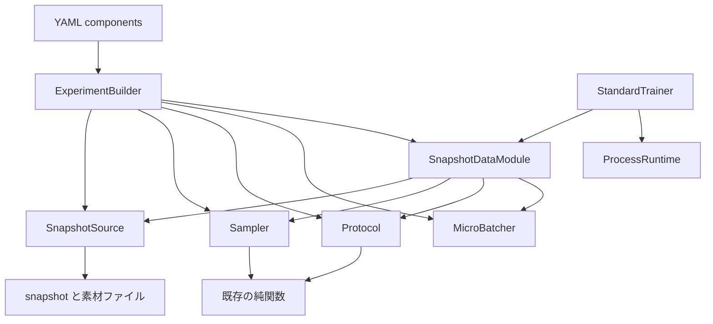

# Data System の構成

Phase 3-A の採用案である。実装は無い。根拠の調査は [PHASE_3A_DATA_AUDIT.md](PHASE_3A_DATA_AUDIT.md)。公開メソッドの契約は [DATA_PUBLIC_API.md](DATA_PUBLIC_API.md)。実装順は [DATA_MIGRATION_PLAN.md](DATA_MIGRATION_PLAN.md)。

## 旧方針からの変更

Phase 0 は、公式データセットごとに既存クラスを 1 枚の DataModule アダプタで包み、式は移さない、としていた（[ARCHITECTURE.md](ARCHITECTURE.md) の「DataModule の範囲」、[MIGRATION_PLAN.md](MIGRATION_PLAN.md) の pipeline 行）。

Phase 3-A はこれを撤回する。撤回するのは「`ReproductionTrainingData` などのインスタンスを新 API の実装にする」ことである。撤回しないのは次である。

- 公式の信号処理、分布、Sampler の特性は、既存の純関数が持っている。書き直して数値を変えない。
- オンライン混合の共通エンジンは作らない（D-01 と並ぶ、実装済みの方針）。
- 学習中に DuckDB を開かない。
- 現行 `python -m src.training.se.cli` と `audio-db-training-v1` は、回帰記録の前に置き換えない。

変更の理由は調査文書の末尾にある。要約すると、旧クラスは Experiment の `train_epoch` と再開単位に合っておらず、Sampler の分布を外から変える入口も無い。数値の本体はクラスではなく関数にある。

## 配置

責務を先に固定し、そのあとディレクトリを決める。

| 責務 | 置く場所 | 学習ステップから呼ぶか |
|---|---|---|
| 評価用レシピ DB | `src/data/` | 否。現行どおり |
| Dataset の登録、staging、監査、snapshot の export | `src/reproduction/db` と `prepare` | 否 |
| 不変 snapshot の読み取り | `src/reproduction/snapshot_reader.py` と `pipeline/store.py` | はい。開くだけで SQL は無い |
| 順序、chunk 計画、正規化、混合、劣化の式 | 既存の純関数（下記の再利用表） | はい。関数呼び出し |
| 学習への供給、再開位置、Experiment の `Batch` | `src/experiments/data/` | はい。これが新しい公開 API |

### 案の比較

案 A は、登録も snapshot も供給も `src/experiments/data/` に置く。案 B は、登録と snapshot 生成を学習パッケージの外に残し、`src/experiments/data/` は供給だけを持つ。案 C は、登録を新しい `src/datasets/` へ移してから案 B と同じ供給を作る。

| 比較 | 案 A | 案 B | 案 C |
|---|---|---|---|
| 責務 | 学習グラフと登録トランザクションが同じパッケージになる | 登録は準備プロセス、供給は学習プロセス | 名前は分かれるが、移す対象は動いている `src/reproduction/db` である |
| 公開 API | DataModule が DuckDB の有無を隠す必要が出る | 供給 API は snapshot パスだけを受ける | 供給 API は案 B と同じ。登録 API の import 経路だけが変わる |
| 依存方向 | `experiments` が DuckDB と `src/data` の登録に依存する。評価が Dataset を使うには `experiments` を import する | 供給は `reproduction.db` を import しない。`reproduction` は `experiments` を import しない | 依存の向きは案 B と同じ。移動の差分が登録 CLI 全体に出る |
| 実装量 | 登録の再実装か、大規模な移設 | 供給パッケージの追加と、純関数の呼び出し | 案 B に加えてパッケージ移動 |
| 既存資産 | `AssetStore` と式を移すかラップする | 式と reader はそのまま呼ぶ | reader の import を書き換える |
| 学習と評価の共有 | 評価の来歴は JSON のままにできるが、登録の置き場所が学習側になる | 来歴 JSON と snapshot hash を共有し、評価は DB を開かない現行契約を維持できる | 同じ。移動が終わるまで二つの登録入口がある |
| モデル追加 | アルゴリズムの閉集合が学習パッケージの中に増える | 新しい式は protocol 関数として足し、登録の `ALGORITHMS` は準備側の制約として残る | 案 B と同じ |
| 研究での差し替え | Sampler を差し替えるには登録コードから分離する作業が先に要る | Sampler は供給側のクラスで、snapshot は差し替えない | 案 B と同じ |
| 移行コスト | 高い。学習が DuckDB を開かない制約を一度崩す | 供給の追加だけ。現行 CLI は無変更で並走できる | 登録の import 変更が、データ供給の正しさと無関係にレビューへ入る |

採用は案 B である。Dataset DB と snapshot の生成は Experiment Framework の内部に置かない。学習が読む契約は、既に export された snapshot ディレクトリである。案 C は、評価や別ツールが `reproduction` という名前を持てない、と分かってから検討する。Phase 3 の実装項目には入れない。

`src/experiments/data.py` は今、モジュールである。Phase 3-B でパッケージ `src/experiments/data/` にし、`TensorPairData`、`Batch`、`EpochView` を `__init__` から今と同じ名前で出す。YAML の `src.experiments.data.TensorPairData` は変えない。この移動は公開 API の変更ではない。

## コンポーネント

独立クラスにするのは、呼び出し側が差し替えまたは単独で試験するものである。公式の式の途中段階はクラスにしない。

| 要素 | 責務 | 持たないもの |
|---|---|---|
| `SnapshotSource` | 1 つの ready snapshot の case、文書、素材パス、`dataset_id`、`snapshot_hash`、profile、claim | 順序、乱数、波形の計算、DuckDB |
| `OrderSampler` | `rank_order` が計算できる平坦 policy の、1 rank の添字列 | 音声、crop の式、chunk |
| `Dfn3IndexSampler` | `plan_online_epoch` が返す添字。波形は作らない | 混合の式 |
| `ChunkSampler` | `plan_chunk_epoch` が返す `(case_id, start, stop)`。この rank の列を `SampleRef` にする | 混合波形、二度目の shard |
| `FixedPairProtocol` | crop 座標と、`render_sample` による noisy / clean | 順序 policy の選択を YAML DSL に分解すること |
| `ChunkProtocol` | 保存済み realization の描画と、`[start:stop]` の切り出し | chunk オフセットの乱数。それは `ChunkSampler` が計画関数に任せる |
| `Dfn3Protocol` | `render_mixture`。1 呼び出しが 3 秒の混合 | reverb や SNR を別 Transform に分けること |
| `SemambaProtocol` | `render_example`。1 呼び出しが劣化と peak 正規化と窓 | 劣化段の YAML 列 |
| `MicroBatcher` | rank 内の `SampleRef` 列を micro-batch に区切る。描画後に末尾 0 で揃える | rank 間の再分割、Optimizer |
| `SnapshotDataModule` | 上記を組み立て、`train_epoch`、`state_dict`、検証、close を Trainer に出す | device 上の全データ常駐、DuckDB、`state_dict` 以外の再開入口 |

`role: data` は `SnapshotDataModule` だけが持つ。Source、Sampler、Protocol、Batcher は `role: other` である。StateRegistry は `other` を保存しない。再開に必要なものは DataModule の `state_dict` に集約する。

Transform という独立クラスは置かない。固定ペアのリサンプル、正規化、窓は `FixedPairProtocol` が `render_sample` に渡す順序のままである。公式の複合処理を、数値が変わらないという理由で段に分けない。研究用に段を足すときは、その段が損失の入力を変えることを試験に書いた Protocol を追加する。汎用の Transform リストは作らない。

### 依存の向き

許す import は次だけである。Phase 3-B でコードに入ったときに、`.agents/PROJECT.md` の現状節を更新する。Phase 3-A の時点では、この import はまだ無い。

- `src.experiments.data` は `snapshot_reader`、`pipeline.store`、`pipeline.order`、`pipeline.seeds`、`pipeline.renderer`、`pipeline.planner` の crop 公開関数、`pipeline.chunking`、`pipeline.online_dfn3` の計画関数、`protocols/online_dfn3`、`protocols/online_semamba`、両 build の `render_realization`、`ids.digest` を呼んでよい。
- `src.experiments.data` は `src.reproduction.db`、DuckDB、`src.training` の Trainer、`src.se`、`src.asr`、`src.evaluation` を import しない。
- `src.reproduction` と `src.training` と `src.se` と `src.asr` は `src.experiments` を import しない。
- モデルは `role: module` のまま `src.se.build_model` を Factory が呼ぶ。DataModule はモデルを知らない。

`ids.digest` は `src.data.recipe.json_hash` を使う。これは登録 ID と同じ正規化（キーソート、小数 6 桁）で plan hash を作るためである。DuckDB は開かない。

### デバイスと先読み

波形の生成と collation は CPU である。`setup` はランクと world size を覚え、snapshot を開く。コーパス全体は GPU へ移さない。

`StandardTrainer` は forward の前に、`inputs` と `targets` と `lengths` が `runtime.device` と違うときだけその device へ移す。Phase 3-B の実装項目であり、Phase 3-A ではコードを変えない。`TensorPairData.setup` が既に device 上へ置いたテンソルは、同じ device への移動で値は変わらない。

prefetch は DataModule の内部スレッドが、次の micro-batch の CPU テンソルを描くことだけを許す。CUDA をそのスレッドから呼ばない。checkpoint には描いた配列を入れない。`state_dict` の `update_index` は、Trainer が消費を終えて書いた次の添字である。

Worker 数は plan hash に入れない。Renderer と Sampler は、スレッドローカルな未 seed のグローバル乱数を読まない。既存関数はこの性質を持っている。新しい描画コードもこれに従う。

### DDP

rank 分割は Sampler が 1 回だけ行う。Batcher も DataModule も、渡された列を rank で割り直さない。これは `TensorPairData` の docstring と同じ契約である。

全 rank が同じ `plan_hash` を計算する。ハッシュの入力は全 rank の `SampleRef` 列である。Phase 2-B の保存前比較が、data 状態の不一致を拒否する。その比較の対象は DataModule の `state_dict` である。

world size が違う再開は、checkpoint の既存規則で拒否する。Data System は world size を変えた列の変換を提供しない。

`per_rank_independent_v1` の rank 間重複は、公式差として stats に残す。DataModule は重複をエラーにしない。

### 動的 Sampler

Phase 3-F まで、重み変更のメソッドは無い。設計上の位置だけを固定する。

- 変えるのは平坦 policy の `OrderSampler` だけである。chunk の ESPnet iterator と DFN3 の順序関数に、暗黙の重みは掛けない。
- 指示するのは Trainer である。Loss や Metric は Sampler を直接呼ばない。Trainer が `data.set_sampling_weights(mapping)` を呼ぶ。
- 適用は、現在開いている `EpochView` ではなく、次の `train_epoch` からである。開いている view の最中の変更は `DataError`。
- 重み表は DataModule の `state_dict` に入る。表が無い checkpoint を、重みを持つ DataModule へ載せるのは `StateError`。
- 重みを変えると、それ以降の epoch の `plan_hash` が変わる。既に保存した epoch のハッシュは遡って変えない。
- 複数 Expert は、Expert ごとに DataModule を別 component にする。共有の可変重みストアは作らない。同じ snapshot ディレクトリを二つが読み取り専用で開くことは許す。

難例のスコア計算、カリキュラムの段、WER による抽出は Data System のクラスにしない。それらを行う Trainer が、上のメソッドへ結果を渡す。

### Official-faithful と Research

DataModule は一つである。分岐でクラスを増やさない。

snapshot の `profile`、`selection_uses_test`、`claim_label` を `identity()` に入れる。公式が test を選択に使っている dataset は、そのフラグが真のまま供給する。独立した汎化性能とは呼ばない。評価側の判定は、現行どおり checkpoint 横の `data_provenance.json` を読む。JSON を書くのは、モデル接続のあとの Trainer である。Phase 3-B の DataModule はファイルを書かない。`lineage()` が `snapshot_provenance_parts` の辞書を返し、後続の Trainer が現行の形式で書く。

研究用に test を使わない実行は、`require_profile: leakage_safe` を kwargs に書いたときだけ、snapshot の profile が違うと `setup` で `DataError` にする。書かなければ拒否しない。公式再現の YAML はこのキーを付けない。

`research_checkpoint_selection` の子 dataset は、親と別の `dataset_id` として読む。DataModule は親子関係を解釈しない。

## 完全一致と統計的再現

次が同じなら、CPU 上の波形は既存の純関数と一致させる。一致の判定は、Phase 3 の試験が最大絶対誤差 0 を記録した範囲だけである。この設計文書は未測定の一致を主張しない。

- `snapshot_hash`、`protocol_id`、seed、epoch、world size、rank、order policy、micro-batch、group size、重み表
- 素材ファイルが snapshot の登録ハッシュと一致すること。`verify_on_read` が偽のとき、この一致は hot path では検査されない。公式忠実の既定は現行と同じく偽である。起動時に全ファイルを読む検査は別フラグにし、既定では走らせない
- Worker 数と prefetch の有無。これらは seed に入らない

次は完全一致の対象外である。

- 公式 Rust、未 seed の `np.random`、worker の `random.randint`、不明の 16 kHz 変換器。現行の文書化された差を、新しい完全一致の定義にしない
- `torch.randperm` の版が違う環境。現行と同じく UNKNOWN
- world size、seed、snapshot、重み表のいずれかが違う再開
- GPU 上のその後の畳み込み。データ供給の一致は CPU テンソルまでである
- ファイルを差し替えたあとの、`verify_on_read` 無効の実行

## 維持する非対称

実装時に「揃える」対象にしない。試験の期待値は現行関数の出力である。

- `head_place` と `tail_zero` はどちらも先頭配置、末尾 0 である。
- DFN3 の検証は、並びの seed に学習 epoch が入り、波形 seed の epoch key は 0 である。
- SEMamba の検証は素材順で、波形の epoch key は 0 である。
- MossFormer の検証だけが `rank_mod_fixed_v1` で shard し、crop は学習 epoch に依存する。MP-SENet の検証は全長で、shard しない。
- DFN3 の world size 1 は最後の短い micro-batch を残す。world size > 1 は先頭の繰り返しで長さを揃える。
- chunk の `epoch` は Trainer の 0 始まりを、計画関数へ渡すとき 1 足す。
- オンライン学習サンプルの波形 seed に rank は入らない。
- `dataset_id` は name と version を含まない。学習側でハッシュを再定義しない。

## Phase 2-C との接続

変えないもの:

- Factory、Builder の段、`role`、`inject`
- Runtime の device、DDP、AMP、`step`、`end_step`
- checkpoint 形式 `audio-db-experiment-v1` の必須キー
- rank 別 RNG は Runtime の `rng_by_rank`。データ計画の乱数はここに混ぜない
- `TensorPairData` の `state_dict` キーと、`update_index` が次の micro-batch であるという契約

Phase 3-B で足す Trainer の変更は二つだけである。どちらも AMP と NCCL の意味は変えない。

1. forward の直前に、バッチテンソルを `runtime.device` へ移す。
2. 実行開始時に、DataModule が `group_size` を持つなら、それが Trainer の `accumulation` と一致することを要求する。一致しなければ `RuntimeFailure`。

`Batch` に optional の `lengths`、`sample_ids`、`realization_ids`、`teacher_kind` を足す。既存の 4 引数構築は残す。`sample_id` は micro-batch 内の sample id をカンマで結んだ文字列のままなので、現行のログ行は壊れない。

## 未決

Phase 3-B の着手を止めないものだけを残す。

| 項目 | 扱い |
|---|---|
| 重み付き抽選の具体的なアルゴリズム | Phase 3-F で名前を付けて試験ベクトルを決める。3-B ではメソッドを置かない |
| chunk と DFN3 への重み | 3-F に含めない。含めるときは名前付きの別 policy として追加する |
| `verify_on_read` を公式忠実の既定で真にするか | 既定は偽。全件ハッシュの所要は未測定なので、既定を変えない |
| 来歴 JSON を書く Trainer | モデルを接続する Phase で、現行 `src/training/provenance.py` の形式を使う。3-B は `lineage()` の辞書まで |
| `src/datasets` への登録コードの移動 | 不採用。再検討条件は上の案 C |
| 公式変換器、Rust RNG、`torch.randperm` の版差 | 未解決のまま。Data System の完了条件にしない |
